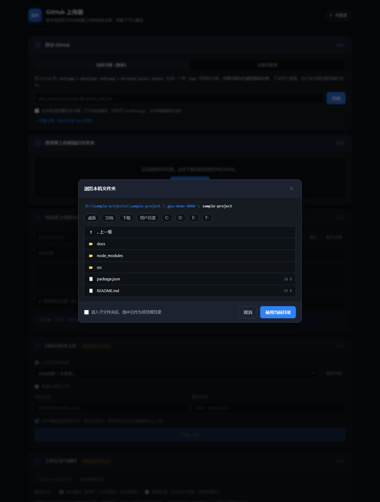
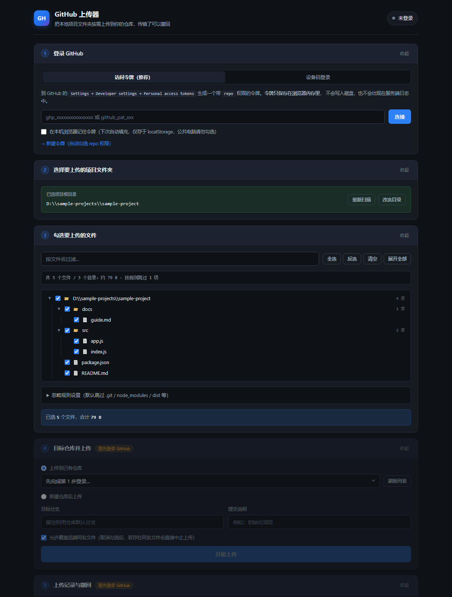

# 使用指南（新手向）

> 这份文档假设你**从没用过命令行、也不了解 Git**，只想把电脑上的项目弄到 GitHub 上去。
> 如果你已经熟悉这些，看 [README.md](./README.md) 会更快。

---

## 目录

- [一、这是个什么东西](#一这是个什么东西)
- [二、它比手动上传好在哪](#二它比手动上传好在哪)
- [三、开始前的准备：检查你的电脑](#三开始前的准备检查你的电脑)
- [四、没装 Node.js？三步装上](#四没装-nodejs三步装上)
- [五、把项目下载到电脑上](#五把项目下载到电脑上)
- [六、启动它](#六启动它)
- [七、拿到你的 GitHub 通行证（令牌）](#七拿到你的-github-通行证令牌)
- [八、完整操作：五步走](#八完整操作五步走)
- [九、传错了怎么办：撤回](#九传错了怎么办撤回)
- [十、常见问题](#十常见问题)
- [十一、注意事项](#十一注意事项)

---

## 一、这是个什么东西

它是一个**只在你电脑上运行的小网页**。你打开它，它会：

1. 让你用 GitHub 账号登录
2. 让你在电脑上挑一个项目文件夹
3. 让你勾选这个文件夹里**想上传哪些文件**（不是整个文件夹无脑全传）
4. 帮你一次性传到 GitHub 上的某个仓库
5. 万一传错了，**可以撤回**

**最重要的一点**：全程不碰命令行、不敲 git 命令、不用记那些奇怪的指令。点点鼠标就行。

它长这样（深色界面，五个步骤从上往下排）：

```
┌─────────────────────────────────────┐
│ 1  登录 GitHub                       │
├─────────────────────────────────────┤
│ 2  选择要上传的项目文件夹             │
├─────────────────────────────────────┤
│ 3  勾选要上传的文件                   │
├─────────────────────────────────────┤
│ 4  目标仓库并上传                     │
├─────────────────────────────────────┤
│ 5  上传记录与撤回                     │
└─────────────────────────────────────┘
```

---

## 二、它比手动上传好在哪

你可能想说：GitHub 网页上不是能直接拖文件上传吗？为什么要多此一举？

对比一下：

| 场景 | GitHub 网页手动上传 | 本工具 |
| --- | --- | --- |
| 上传一个文件夹里的 50 个文件 | 要么一个个拖，要么整个文件夹拖（但会把 `node_modules` 这种垃圾也传上去） | 扫描出文件树，勾选想要的，其余排除 |
| 想跳过 `node_modules`、`.git`、安装包 | 得自己一个个避开 | 自动跳过，还能自定义规则 |
| 传完发现传错了 | 得逐个文件删，或手动 revert | 一键撤回，两种方式可选 |
| 项目在电脑硬盘上 | 得先找到文件夹再拖 | 内置文件夹浏览器，直接选目录 |
| 下次想再传一次 | 重新拖一遍 | 记住登录，勾选后直接传 |

一句话：**当你要传的是"一个项目"而不是"几个文件"时，它省事得多。**

---

## 三、开始前的准备：检查你的电脑

你只需要一个东西：**Node.js**（版本 18 或更高）。

### 先检查有没有装

1. 按 `Win + R`，输入 `cmd`，回车，会弹出一个黑色窗口
2. 在里面输入这行，然后回车：

```
node -v
```

3. 看结果：

- 如果显示类似 **`v18.x.x`、`v20.x.x`、`v22.x.x`** → ✅ 已经装好了，跳到[第五节](#五把项目下载到电脑上)
- 如果显示 **`v16.x.x` 或更低** → ⚠️ 版本太旧，需要升级，看下一节
- 如果显示 **`'node' 不是内部或外部命令`** 或 **`command not found`** → ❌ 没装，看下一节

> **为什么需要 Node.js？** 因为这个小工具的后台程序是用 Node.js 跑的。就像看视频需要播放器一样，它需要一个"运行环境"。这是唯一需要额外安装的东西。

---

## 四、没装 Node.js？三步装上

1. 打开官网：<https://nodejs.org/zh-cn>
2. 页面上会有两个大按钮，**点左边那个写着「LTS」的**（LTS 意思是"长期支持版"，最稳定，适合大多数人）
3. 下载完双击安装，一路点「下一步」即可，**中间不需要改任何选项**

装完后，**关掉之前的黑色窗口，重新开一个**（这一步很重要，否则它不认识新装的程序），再输一次：

```
node -v
```

看到版本号就成功了。

---

## 五、把项目下载到电脑上

有两种拿法，任选其一：

### 方法 A：下载压缩包（更简单，推荐新手）

1. 打开本项目的 GitHub 页面
2. 点绿色的 **`< > Code`** 按钮 → **`Download ZIP`**
3. 下载完解压到你喜欢的位置，比如 `D:\github-web-uploader`

### 方法 B：用 git 克隆（如果你已经有 git）

```
git clone <本项目的地址>
```

> 无论哪种方式，解压/克隆后的文件夹里应该能看到 `server.js` 这个文件。**记住这个文件夹在哪**，下一步要用。

**注意**：这个项目**不需要** `npm install`。

新手常问："不用装依赖吗？"——是的，不用。它只用 Node.js 自带的功能写的，所以拿到了就能跑。

---

## 六、启动它

### 最简单的方式（Windows）

进入项目文件夹，**双击 `start.bat`**。

会弹出一个黑色窗口，显示：

```
  ┌──────────────────────────────────────────────┐
  │   本地 GitHub 上传器 已启动              │
  └──────────────────────────────────────────────┘

  打开浏览器访问：  http://127.0.0.1:5178
```

看到这个就说明**启动成功**。

### 用命令行启动（所有系统都可以）

打开命令行，进到项目文件夹，然后：

```
cd /d D:\github-web-uploader    ← 换成你自己的实际路径
node server.js
```

### 然后打开网页

在浏览器地址栏输入：**<http://127.0.0.1:5178>**

（`127.0.0.1` 意思是"本机"，这个网页只存在你自己电脑上，别人访问不到。）

> ⚠️ **这个黑色窗口不要关掉！** 关掉窗口 = 关掉服务，网页就打不开了。
> 用完了想关闭，直接关掉这个窗口，或者在窗口里按 `Ctrl + C`。

### 启动失败怎么办

**提示"端口 5178 已被占用"**：说明已经有一个在跑了，或者别的程序占了这个端口。换个端口启动：

```
node server.js --port 5179
```

然后网页地址也要跟着改成 <http://127.0.0.1:5179>。

---

## 七、拿到你的 GitHub 通行证（令牌）

这一步是新手最容易卡住的地方。慢慢来，跟着做。

**为什么需要它？** 网页要帮你上传文件到你的 GitHub，得先证明"你确实是你"。我们用一样叫**令牌**（Token）的东西来证明——它就像一把一次性的钥匙，比直接输密码安全得多。

### 获取步骤

最简单的方法：**网页第 1 步里就有一个直达链接**。

1. 在网页第 1 步「登录 GitHub」区域，点这行蓝色小字：
   **→ 新建令牌（自动勾选 repo 权限）**

   它会自动帮你打开 GitHub 的令牌生成页，并且**权限已经勾好了**。

2. 在打开的页面上：
   - **Note**（备注）：随便写，比如 `本地上传工具`
   - **Expiration**（有效期）：建议选 `90 days`（90 天）
   - **Select scopes**（权限）：**不用动**，链接已经帮你勾好了
3. 拉到最底下，点绿色按钮 **`Generate token`**
4. 页面上会出现一串以 **`ghp_`** 开头的字符 —— **这就是令牌**

> ⚠️ **这串字符只会显示这一次！** 关掉页面就再也看不到了。
> 请立刻**复制**它。（如果没复制就关了，删掉重新生成一个即可，不影响。）

### 填进网页

1. 回到本工具的网页，第 1 步的输入框里**粘贴**那串令牌
2. 点「**连接**」

看到右上角变成绿色的「**已登录：你的用户名**」，就成功了。

**新手常见问题**：

- **提示"令牌无效或已过期"** → 检查是不是复制时漏了开头或结尾，或者粘贴时带了空格
- **要不要勾"在本机浏览器记住令牌"？** → 你自己一个人用的电脑，可以勾，下次自动登录。公共电脑**千万别勾**。

> **还有第二种登录方式**（「设备码登录」），需要你先去 GitHub 创建一个 OAuth App，步骤更多。新手**用上面这个令牌方式就够了**，不用管它。

---

## 八、完整操作：五步走

假设你要把 `D:\我的项目` 这个文件夹传到 GitHub。

### 第 1 步：登录 GitHub

见上一节。登录成功后，**第 4 步和第 5 步**会解锁。

（顺带说明锁定顺序：第 2 步选文件夹本来就不需要登录；第 3 步在你选完文件夹后解锁。所以看到后面几步是灰的别着急，按顺序做下去就会亮起来。）

### 第 2 步：选择要上传的项目文件夹

1. 点蓝色按钮「**浏览本机文件夹**」
2. 弹出一个窗口，你可以在里面层层点进去找到你的项目
   - 顶部有快捷入口：**桌面 / 文档 / 下载 / 用户目录**，也可以直接点 **C: / D: / E:** 等盘符
   - 上面那行是路径面包屑，点任意一段可以直接跳过去
3. 找到你的项目文件夹后，点右下角「**使用当前目录**」



选好后，这一栏会显示你选的路径，旁边有「**重新扫描**」和「**改选目录**」两个按钮备用。

### 第 3 步：勾选要上传的文件

选完目录后，它会自动扫描并列出文件树。



**关键的几件事**：

- **默认已经帮你勾好了合理的文件**（普通源码文件），一些明显不该传的会自动跳过
- **自动跳过**的东西：`.git`（版本记录）、`node_modules`（依赖包，通常几万个文件）、`dist`/`build`（构建产物）等
- **添加/取消整个文件夹**：点文件夹前面的勾选框
  - 勾选框显示 **■（半选状态）** 表示"这个文件夹里只勾了一部分文件"，不是出错
- **顶部工具栏**：
  - 「**全选**」勾上所有文件，「**反选**」反转当前选择，「**清空**」全部取消，「**展开全部**」展开/收起所有文件夹
  - 左边那个搜索框可以**按文件名过滤**，比如输入 `js` 就只看带 js 的文件
- 最底下会实时显示「**已选 N 个文件，合计 X MB**」——上传前确认一下数量对不对

**小技巧**：如果某个子文件夹你不想传（比如存着一堆素材图片），直接把它前面的勾去掉就行。

**如果它跳过了你想传的文件**：展开中间的「**忽略规则设置**」，把对应的那行删掉，然后点「**应用并重新扫描**」。

> ⚠️ **这些文件万一被标成红色、勾不上**：说明单个文件超过了 95MB，GitHub 不允许。需要你自己想别的办法处理（比如用 Git LFS）。

### 第 4 步：选择目标仓库并上传

1. **选仓库**：
   - 想传到**已有的仓库**：在「上传到已有仓库」下的下拉框里选一个
   - 想**新建一个仓库**：点「新建仓库后上传」，填一个仓库名（只能用字母、数字、点、下划线、短横线），可勾选「私有」
2. **目标分支**：不懂的话**留空**，它会用仓库的默认分支（一般是 `main`）
3. **提交说明**：随便写一句，比如「初始化项目」。这是给你自己以后看的备注
4. **「允许覆盖远端同名文件」**：默认勾着
   - 保持勾选：同名的文件会被你本地的版本**覆盖**
   - 取消勾选：如果仓库里已经有同名文件，会**直接中止上传**并告诉你是哪些文件（更保险，适合往已有项目里加文件）
5. 点「**开始上传**」

上传时会显示进度条。看到绿色的「**上传成功！**」就完成了，同时会告诉你的提交号和文件数量。

### 第 5 步：上传记录与撤回

见下一节。

---

## 九、传错了怎么办：撤回

**这是本工具最实用的功能之一。**

上传成功后，第 5 步会列出你刚才传的内容，带一个红色的「**撤回这次上传**」按钮。

### 两种撤回方式，选哪个？

界面上有个「撤回方式」的单选，两个选项：

| | 安全撤回（默认，推荐） | 强制回退 |
| --- | --- | --- |
| **做了什么** | 又提交了一次"撤销操作"，把文件内容改回上传前的样子 | 直接把记录拨回到上传之前 |
| **文件内容** | ✅ 恢复到上传前 | ✅ 恢复到上传前 |
| **历史记录** | ✅ 完整保留，能看到"传了又撤了" | ❌ 这次上传的记录**彻底消失**，像没发生过 |
| **能否后悔** | ✅ 可以再撤销这次撤回 | ❌ 不可逆 |
| **适合谁** | **所有人，尤其是新手** | 只在你确定"这次上传不该留痕"时用 |

**新手结论：一律用默认的「安全撤回」就行。**

### 操作

1. 确认选中「**安全撤回**」
2. 点「**撤回这次上传**」按钮
3. 弹出确认框，看清楚是哪个仓库、哪个分支、几个文件，点确定
4. 看到绿色提示就成功撤回

### 几点说明

- 撤回按钮**只在本次你打开网页、上传成功的记录上出现**。关掉网页重开，历史记录会清空（已上传的内容当然还在 GitHub 上，只是本工具不再显示"可撤回"按钮了）
- 点「**读取该仓库最近提交**」可以看到仓库最近的提交记录，但**别人的或你之前用别的方式传的提交，本工具不会给撤回按钮**（这是保护机制，防止误操作）
- 想看上传结果，点记录里的「**在 GitHub 查看**」会直接打开对应的网页

---

## 十、常见问题

### 启动相关

**Q：双击 `start.bat` 一闪而过就没了？**
A：说明没装 Node.js，或者没装成功。回到[第三节](#三开始前的准备检查你的电脑)检查。

**Q：网页打不开 / 显示"无法访问此网站"？**
A：1）先确认那个黑色窗口还开着、没有报错；2）确认地址是 `http://127.0.0.1:5178`（不是 `https`，也不是 `0.0.0.0`）；3）如果换过端口，地址里的端口号要跟着改。

**Q：可以关掉黑色窗口吗？**
A：可以，那就等于关闭了这个工具。下次要用重新启动一次即可。

### 登录相关

**Q：令牌忘了存下来怎么办？**
A：回 GitHub 把旧的删掉、重新生成一个即可。

**Q：提示"令牌无效或已过期"？**
A：检查是否复制完整（要以 `ghp_` 开头）、有没有多余空格；或者令牌确实过期了（重新生成）。

**Q："权限不够"、"私有仓库需要 repo 权限"？**
A：生成令牌时没勾对权限。用网页里那个「新建令牌」链接重新生成一个，权限它会自动勾好。

### 上传相关

**Q：为什么 `node_modules` 没被传上去？**
A：故意跳过的。那是依赖包，几万个文件，GitHub 也不建议传（正确做法是用 `package.json` 让别人自己装）。同理还有 `.git`、`dist`、`build`。

**Q：我就是要传 `dist` 怎么办？**
A：在第 3 步展开「忽略规则设置」，把 `dist` 那一行删掉，点「应用并重新扫描」。

**Q：某个文件勾不上 / 显示红色？**
A：单个文件超过 95MB。GitHub 单个文件最大 100MB，超了就传不了。

**Q：上传到一半失败了？**
A：看红色错误提示。常见原因：令牌没权限、网络断了、仓库名写错了。**不用担心传一半留下烂摊子**——本工具是"要么全部成功、要么整体失败"，不会留下残缺状态。

**Q：能传到别人的仓库吗？**
A：只有你**有写入权限**的仓库才会出现在下拉列表里（比如你自己建的，别人邀请你协作的）。

### 撤回相关

**Q：撤回后文件真的没了吗？**
A：用「安全撤回」，文件**内容**回到上传前，但"传过又撤回"这个记录会留在历史里。
用「强制回退」，那次上传的记录会消失。

**Q：能撤回别人传的东西吗？**
A：本工具只对"你自己通过它上传的"提供撤回按钮，避免误删。

**Q：撤回按钮点不了 / 没有？**
A：说明那条记录不是本次会话里用本工具传的。刷新或重开网页后，历史按钮会消失。

---

## 十一、注意事项

**关于安全**

- 这个服务**只在你自己电脑上**运行，别人访问不到
- 你的令牌**不会**被写到硬盘上，也不会进日志（除非你自己勾了"记住令牌"，那也只存在你自己的浏览器里）
- 项目里如果有 `.env`、密钥文件、密码之类的东西，**上传前请务必手动取消勾选**——默认规则不会自动帮你跳过它们

**关于使用范围**

- 它只做**上传**，不会删除你仓库里已有的文件（撤回除外）
- 上传是"叠加"的：传新文件不会影响仓库里原有的其他文件

**关于令牌**

- 令牌等于你的账号钥匙，**不要发给任何人**，也不要把含令牌的截图发出去
- 建议设个**有效期**（比如 90 天），到期重新生成，降低风险
- 如果怀疑泄露，立刻到 GitHub 的令牌页面把它**删除**

---

**祝使用顺利。有任何卡住的地方，欢迎提 Issue。**